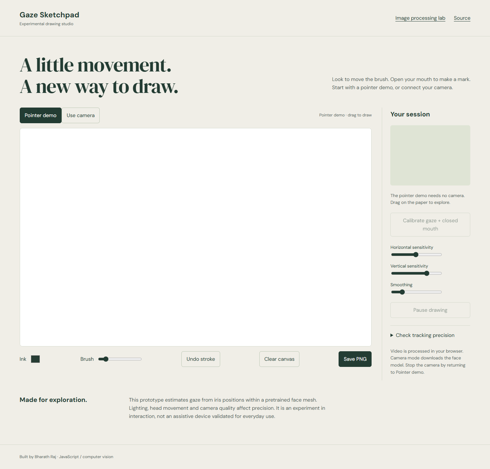

# Gaze Sketchpad

Drawing with a mouse assumes that a pointer is the right input for everyone. This experiment explores an alternative: iris-relative face landmarks move a brush, while mouth opening controls whether it draws.



## Demo

Local preview works with the setup below. GitHub Pages publication is pending destination authentication; a live URL will be added after verification.

## What it does

- Large drawing canvas with a secondary camera preview and labeled tracking/drawing states.
- Guided center calibration, sensitivity controls, smoothing and a dead zone.
- Tracking-loss and invalid-landmark handling lift the brush rather than bridging disconnected strokes.
- Undo up to 20 actions, clear and PNG export. A labeled pointer demonstration works without a webcam.
- Separate image-processing experiments in `processing.html`; the supplied filters and experiments remain available.

## Run locally

```sh
python -m http.server 8000 --bind 127.0.0.1
```

Open http://127.0.0.1:8000/ in a modern browser. Run the command inside this repository. Do not open `index.html` directly from disk: local datasets/model assets use HTTP. Python 3 is only a local static server; no application build is required.

## Controls

Start in Pointer demo and drag on the paper. For camera input, select Enable camera, allow permission, face the camera, look at the center target with your mouth closed, then select Calibrate. Open your mouth to draw. Close it to lift the brush. Pause or recalibrate after moving your head.

## Architecture and decisions

`studio.js` owns the canvas, camera lifecycle, stroke history and interface. `GazeTracker.js` measures iris offsets relative to both eye corners and applies calibrated mapping, clipping and exponential smoothing. `mouthOpenDetector.js` normalizes lip aperture by eye separation and uses temporal agreement. Both calibration and live tracking use the same measurement functions. The landmark model is pretrained ml5 FaceMesh; this project implements the mapping and interaction around it, not the model training.

## Limitations

One-point calibration assumes a stable head and camera distance; it is not a clinical gaze tracker or a verified assistive device. The three-second measurement reports center error and jitter in normalized canvas coordinates for one session, using rendered samples. No population accuracy benchmark is claimed. Human gaze accuracy and camera quality still need recorded hardware sessions. Model/library downloads need a connection; the stream is processed in the browser and is not uploaded by application code.

## Validation

Pointer stroke/undo/export and camera denial passed in Edge. Synthetic landmark checks cover equal calibration/update calculations, collapsed eyes, NaN coordinates and mouth fail-closed handling. The real pinned ml5 model loaded with a browser-generated synthetic camera; no personal camera was used. Human calibration accuracy remains unmeasured.

## Third-party attribution

ml5.js and its pretrained FaceMesh dependency are external dependencies; p5.js is used by the image-processing mode. License notices and original code comments are retained. Fonts are DM Sans and DM Serif Display via Google Fonts.

